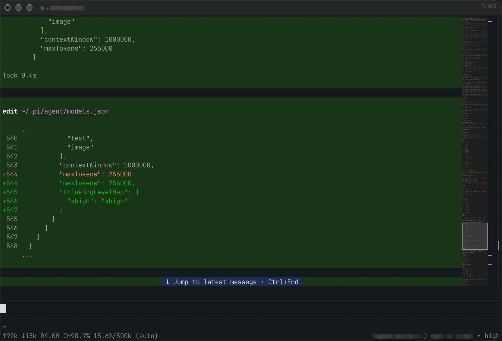

# pi-visible-scrollbar

为 Pi 全屏会话添加输入标记、按需加载的只读历史页，以及可选的文字缩略图。长会话先显示原生正文，旧历史在需要阅读时再加载，不会全部塞回当前正文。

## 效果预览



图为早期版本开启缩略图后的效果示意。默认只显示输入标记和原生滚动条；使用 `/scrollbar minimap on` 开启试验性缩略图。

## 功能

- **输入定位**：点击当前视图中的输入标记；多条输入重叠时展开列表选择。
- **全部分支输入目录**：后台准备输入目录，支持重复输入、技能调用、纯图片和空输入；压缩前输入也可选择。
- **按需历史页**：旧输入进入只读分页视图，可翻页、查找、展开工具输出，随时返回原生实时正文；Bash 完整输出保存失败的提示也会保留。
- **跨页查找与复制**：在当前分支查找正文，或按输入编号复制一段对话，不必把旧历史全部打开。
- **原生滚动与可选缩略图**：保留原生滑块、滚轮和跟随输出；缩略图支持拖动视口框和点击文字定位。
- **不改会话**：不重发输入、不切换分支、不改草稿或模型上下文；没有模型调用、网络请求、遥测或额外 token 开销。

## 安装

支持 **Pi 1.6.0 及以上版本的全屏模式**，需要 Node.js 22.19 或更新版本。低于 1.6.0、`regular` 模式或布局不兼容时不挂载此扩展。

### 从 GitHub 安装

```sh
pi install git:github.com/llc2214926/pi-visible-scrollbar
```

安装后重新启动 Pi，或执行 `/reload`，然后使用全屏模式：

```sh
pi --tui-mode fullscreen
```

### 本地试用

在仓库目录中：

```sh
npm install --ignore-scripts
pi --no-extensions --extension ./index.ts --tui-mode fullscreen
```

长期使用可安装本地目录：

```sh
pi install /absolute/path/to/pi-visible-scrollbar
```

避免同时启用其他替换会话布局或滚动条的扩展。

## 用法

### 阅读旧历史

1. 执行 `/scrollbar list`，按**输入编号或预览文本**筛选，用方向键选择、`Enter` 跳转；`PgUp` / `PgDn` 或滚轮翻页，`Esc` 关闭。
2. 输入仍在原生正文中时直接定位；否则打开只读历史页。纯图片、空输入会显示占位文字。
3. 页头和页尾提供 `Previous` / `Next`、`Inputs`、`Find`、`Expand`、思考显示开关及 `Live`。展开和思考开关只影响历史阅读，不改 Pi 的全局设置。
4. 点击 `Live`、按 Pi 的 `Ctrl+End`，或执行 `/scrollbar end`，返回原生底部并继续跟随输出。弹窗打开时先按 `Esc` 关闭。

**历史页不是整条会话的完整长页面。** 滑块、输入标记和缩略图表示当前视图；Pi 原生搜索及鼠标选区也只覆盖当前视图。跨页阅读使用翻页命令，跨页查找和复制使用下表中的 `find` / `copy`。

### 命令

| 命令 | 功能 |
| --- | --- |
| `/scrollbar on` / `/scrollbar off` | 启用或关闭；关闭后恢复原生正文和滚动条 |
| `/scrollbar status` | 查看当前视图/全分支输入数量、加载状态和不可用原因 |
| `/scrollbar list` | 从当前分支的全部用户输入中选择 |
| `/scrollbar prev` / `/scrollbar next` | 定位上一条或下一条用户输入 |
| `/scrollbar page prev` / `/scrollbar page next` | 翻到上一页或下一页旧历史 |
| `/scrollbar find TEXT` | 在分支正文中查找文字并打开匹配页；重复相同查询可继续查找 |
| `/scrollbar find` | 打开查找输入框 |
| `/scrollbar copy 1-5` | 将第 1–5 条输入及其回复复制到剪贴板，输出纯文本 |
| `/scrollbar copy 5` | 复制第 5 条输入及其回复 |
| `/scrollbar end` | 返回原生底部并恢复跟随输出 |
| `/scrollbar minimap on` / `/scrollbar minimap off` | 开启或关闭试验性文字缩略图 |

`find` 和 `copy` 会展开工具输出；思考内容是否包含在内遵循当前历史阅读设置。输入编号以 `/scrollbar list` 为准。输入目录尚未就绪时会提示后台加载，正文和草稿仍可使用。

### 鼠标操作

| 位置 | 操作 |
| --- | --- |
| `━` 输入标记 | 单击定位这条输入 |
| `≡` 密集标记 | 悬停或点击展开候选列表，再点击具体输入 |
| 密集输入列表 | 滚轮翻页，点击标题或按 `Esc` 关闭 |
| 最右侧原生滑块 | 拖动滚动；点击轨道跳转 |
| 缩略图视口框 | 拖动浏览当前视图 |
| 缩略图文字 | 单击定位；框外拖动不会滚动正文 |

### 缩略图使用条件

- 需要直接使用支持 **iTerm2 或 Kitty 图像协议**的终端，并允许 Pi 显示终端图像。`terminal.images: false`、`PI_IMAGE_PROTOCOL=none` 或 tmux、screen、Zellij 会禁用缩略图。
- iTerm2 3.6 及以上通过 Kitty 协议显示缩略图，避免将预览当作可拖出的内嵌图片。3.6.0–3.6.4 使用 `RGBA (kitty)`，避开旧版 iTerm2 重绘时缩略图消失的问题；3.6.5 及以上使用 `PNG (kitty)`。若终端已出现“在任意位置拖动都带出旧图片”的状态，更新并 `/reload` 后，按住 `Option` 单击一次正文空白处可清除旧状态；3.6 以前的 iTerm2 仍使用内嵌图片。
- 默认导航条占 3 列；开启缩略图后增加约为正文宽度 6% 的预览区域，不覆盖正文。
- 终端不足 60 列时暂停缩略图，放宽后恢复；不支持图像时仍可使用标记和原生滑块。
- 弹窗或搜索打开时暂时隐藏缩略图。预览采用微缩文字，不会把所有旧历史挤进一屏；字体取决于系统，emoji 使用方框占位，附件不显示为原图。

## 兼容性与限制

- 历史页每页最多 256 行。调整宽度或打开特别长的消息时可能需要等待，但可以继续输入或返回实时正文。
- 历史页采用标准文本呈现，不执行第三方自定义卡片或 Markdown 变换器。工具卡片可能与原生显示不同，Bash 输出为纯文本，图片仅显示占位；原生实时正文不受这些限制影响。
- 查询最多 1024 个字符，单次复制最多 32 MiB。特别大的单条记录或异常渲染行可能被安全限制拒绝；缩略图遇到过大文本会退回标记模式。失败原因可用 `/scrollbar status` 查看，关闭后重新开启可重试。
- 本扩展不修改 Pi 内核。**Pi 自己读取会话文件、首次排版大量原生卡片或巨型当前消息时的停顿，仍可能发生**；本扩展不承诺让这些原生操作变成异步。

## 配置

开关命令会自动保存设置，通常无需手动编辑。配置文件是 `<agent-dir>/visible-scrollbar.json`，默认位于 `~/.pi/agent/visible-scrollbar.json`：

```json
{
  "enabled": true,
  "experimentalMinimap": false
}
```

手动修改后执行 `/reload`。配置格式错误时会提示原因并停止启用。

---

采用 [MIT 许可](LICENSE)。参考项目与许可归属见 [NOTICE.md](NOTICE.md)。
